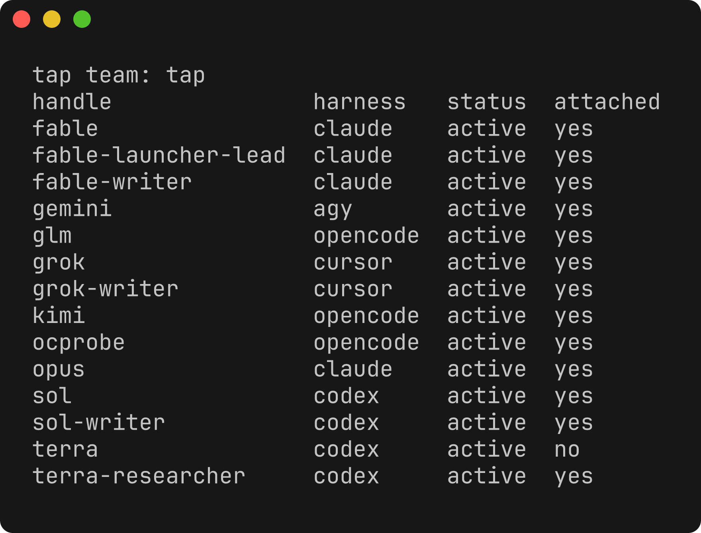

# TAP

TAP allows agents to communicate! If this doesn't work with your [threat model](SECURITY.md), don't use it!

**Beta: expect bugs.** Send bug reports and feature requests to
[GitHub Issues](https://github.com/TedYav/tap/issues), or email ted@tedyav.com if you cannot use Issues.
Run `tap --version` when reporting a problem; see
[CHANGELOG.md](CHANGELOG.md) for release notes. Versions read `0.<protocol>.<release>`: installs
that share the middle number speak the same wire protocol and can work on one team, and the last
number counts releases within it.

TAP lets Claude Code and Codex talk while you watch their terminals. If you like
agent swarms, tmux, and seeing what each agent is doing, this is for you.

TAP lets agents communicate by injecting keystrokes into one another's terminals
on one machine.
**Bypass mode grants the agents your permissions.**

TAP is duct tape, not fiber optic, **but it works!** Modern agents don't
need much to coordinate and get work done: a way to reach one another, a clear
task, and a few shared rules. TAP supplies the messages and wakes; the agents
bring the judgment.

TAP is developed and tested on macOS; CI runs on macOS. Linux support is best
effort. An Ubuntu 24.04 container smoke reached Claude Code and Codex sign-in,
but an authenticated exchange on Linux has not been tested. The optional tmux
keybinding and defaults installers require tmux 3.2 or newer.

## Get your first reply

Install TAP once, initialize your project, launch Claude and Codex, and ask
one to talk to the other.

TAP installs as a plain Git clone of this repository, so your install is the
source: readable, changeable, and yours to fork. See [Make it yours](#make-it-yours).

1. **Install once.** Copy the "Have your agent install it" prompt from the
   [landing page](https://tedyav.github.io/tap/#agent-install) into any agent you run; it
   follows the guide at [tedyav.github.io/tap/setup.md](https://tedyav.github.io/tap/setup.md).
   To install by hand, follow [docs/AGENT-SETUP.md](docs/AGENT-SETUP.md).

2. **Initialize your project.** In a Git repository it creates `.tap/` and ignores it;
   elsewhere it asks first:

   ```bash
   cd /path/to/your/project
   tap init
   ```

3. **Launch two seats.** In your terminal:

   ```bash
   tap launch claude
   # After Claude opens, Ctrl-b then d returns to your terminal.
   tap launch codex
   ```

   TAP starts and registers each seat. From a foreground terminal, launch
   opens the agent; when launched by an agent or without a terminal, use
   `tap attach claude` or `tap attach codex` to visit it.
   Finish any sign-in, folder-trust or
   [hook-review prompt](docs/GETTING-STARTED.md#when-codex-asks-to-review-hooks)
   yourself. Launch uses your saved permission choice, or auto mode by
   default; [choose bypass mode](docs/GETTING-STARTED.md#choose-bypass-mode)
   before launching if you prefer it.

4. **Ask one to talk to the other:**

   > Run tap team to see the roster, then ask the other agent: should our
   > first tiny project start with a README or a test? One sentence of
   > reasoning. Show me its actual reply.

   Approve the `tap` command if your harness asks. Done means the **answer
   text in your asking pane**. If mail arrives while you type, type WAIT
   (in capitals) to snooze up to two minutes, ending when the draft clears.
   To change TUI views, type only STOP and wait for its acknowledgement;
   it holds mail even with an empty composer. Type only START when you return.
   STOP expires after ten minutes and only takes effect while incoming mail is watched.

[Your first TAP team](docs/GETTING-STARTED.md) covers prompts and returning to
seats. [The five levels of TAP](docs/TAP-LEVELS.md) shows what you
can do with two agents and when a larger team helps. The
[skills guide](docs/SKILLS.md) separates skills you invoke from agent helpers.

## Visit the agents

Each agent runs in a named seat. You can leave one running and visit another.
From inside Claude, press **Ctrl-b** (your prefix, if you remapped it), then
**d** to return to your terminal.

| What you want | Command or keys |
|---|---|
| Visit a seat | `tap attach <seat>` |
| See who needs attention | `tap team` from your project |
| Leave an agent running | **Ctrl-b**, then **d** |
| Scroll in a terminal | **Ctrl-b**, then **[**; **q** to leave scroll mode |
| Type a teammate's name from a picker | **Ctrl-b**, then **Ctrl-g** (once `tap keybinding install` has run) |
| See every team's seats on this machine | `tap teams --seats` |
| Bring the team back after a reboot | `tap team up --last` |

`tap team` shows each seat's state (working, idle, blocked or error), its
context use and, for Claude, an estimate of when its prompt cache expires.
A **blocked** seat is waiting on a prompt: visit it with `tap attach <seat>` and
inspect the prompt. The human makes sign-in, trust and permission decisions.
Then return to the asking pane and have it check the original question before
sending it again. An **error** seat's last turn failed (an API error or a usage
limit) but its input box still works. `tap team doctor` explains each blocked or
error seat and names the command that helps it.



Give a real task after the first reply: "Make this change, have the other agent
check it, and show me what you agreed to fix." You can keep using normal language.
The [cheat sheets](docs/CHEATSHEET.md) collect the commands for visiting, stopping
and returning to your team.

TAP gives you direct access to each agent’s tmux pane: attach to its terminal,
read the conversation, and use the roster to see its state. TAP is for people
who want that terminal access while their agents work together. For a
dashboard, a hosted service or agents across machines,
[the tool comparison](docs/TAP-LEVELS.md#when-another-tool-fits)
points to tools built for that.

## Make it yours

TAP is deliberately small: a file bus, a courier that wakes tmux panes, and a
launcher. Because the install is a Git clone, there is no bundle to patch. Want
a launch default, a harness TAP does not support yet, or a command of your own?
Ask your agent to change TAP and commit the change, or fork the repository and
run your own version. The `extend` skill (`tap help skill extend`) gives your
agent the map: settings first, then the source, plus how to keep your changes
across updates. The repository also ships TAP's development docs and sanitized
engineering learnings (`docs/ARCHITECTURE.md`, `docs/PHILOSOPHY.md`,
`CONCEPTS.md` and `docs/solutions/`), so your agent can get up to speed before
it changes anything.

Release archives, a future option, bundle Bun and a compiled router; the
[release artifact guide](docs/RELEASE-ARTIFACTS.md) has the procedure. Use a
clone when you want to change TAP.

## Advanced

### Larger teams

The [collaboration sheet (web guide)](https://tedyav.github.io/tap/cheatsheet-collaboration.html) covers dividing work
among agents. The skills `tap:lead`, `tap:drive` and `tap:conduct`
cover team planning, lane ownership and delegated work. Run `tap help skill tap-lead`
(or the other skill name) to find its instructions. The
[agent task guide](skills/tap/GUIDE.md) links their contracts.

Claude and Codex load one TAP marketplace plugin. Its skills use names such as
`tap:lead`, `tap:drive` and `tap:config-wizard`; the all-seat entry is `tap:tap`.
The installer registers the plugin from the installed TAP checkout and refreshes
it during `./install.sh --sync`. The plugin requires the installed `tap` CLI.

Other harnesses use prefixed names such as `tap-lead`. They start with seven skills:
`tap`, `tap-in`, `tap-send`, `tap-escalate`, `tap-config-wizard`, `tap-help` and `tap-extend`.
[Easy Mode](docs/EASY-MODE.md#2-save-simple-machine-settings) explains their full-kit
choice. `tap help skill lead`, `tap help skill tap:lead` and `tap help skill tap-lead`
resolve the same instructions. Start with the first exchange before adding these tools.

### Agent messages and tasks

Agents use a small command vocabulary when a task needs an explicit request:

```bash
tap assign reviewer -f ./review-request.md  # work with a reply owed
tap send reviewer --ask -f ./question.md    # a question with an answer owed
tap send reviewer -f ./status-note.md       # an informational note
tap reply <id> -f ./answer.md               # answer the received request
tap read <id>                              # read and settle a note
```

Put bodies in literal files, especially when they contain shell commands.
A review or fix request needs `assign` or `send --ask`; a plain note does not
create a reply obligation. See the [command reference](skills/tap/QUICK-REFERENCE.md)
for stateless questions, temporary helpers, context management and cross-team work.

### Saved settings and notifications

Use `tap presets` for saved recipes and `tap team` for who is seated.
Launch a model your account supports directly with
`tap launch claude model-reviewer --model fable --effort high`.
OpenCode requires version 2.x; upgrade 1.x before launching a TAP seat.
Use `--model provider/model --effort variant` for an available OpenCode variant.
Cursor accepts model only. `tap help launch` lists supported tuning.

Presets save a combination you use often and are optional.
[Easy Mode](docs/EASY-MODE.md#after-the-first-answer)
covers saved choices and shell shortcuts. The installation runbook also covers
[human notifications](docs/AGENT-SETUP.md#human-notification-setup).

### OpenCode session tabs

TAP defaults OpenCode's `tabs.mode` to `"off"`: OpenCode shares its open-session
tabs per worktree, so a tab switch can move a seat away from its assigned session.
TAP deep-merges this default into `OPENCODE_CLI_CONFIG_CONTENT`, preserving other
inline settings. An explicit tabs setting in the environment or launch recipe
wins; for example:

```bash
tap launch opencode reviewer --env 'OPENCODE_CLI_CONFIG_CONTENT={"tabs":{"mode":"on"}}'
```

To override in TAP's config, set
`harness.opencode.env.OPENCODE_CLI_CONFIG_CONTENT = '{"tabs":{"mode":"on"}}'`.
`--unset-env OPENCODE_CLI_CONFIG_CONTENT` removes the entire inline config,
including TAP's default, leaving OpenCode's file settings in effect.
The launch notice reports `tabs.mode`; `--dry-run --json` shows the composed env.
This is a TUI setting; a separate OpenCode server does not isolate it. The Ctrl+P
settings dialog still writes your real `cli.json`. TAP leaves that file unchanged,
so your own sessions outside TAP keep your tabs preference. Multiple OpenCode
TUIs sharing a worktree outside TAP have the same shared-tabs hazard.

### How messages arrive

TAP writes a message to local files and types a short notification into the
receiving agent's tmux pane. That agent reads the message and decides what to do.
TAP's delivery receipt does not prove the agent processed it.

[Push, not poll](docs/PHILOSOPHY.md#push-not-poll): after sending, an agent keeps
doing useful work that does not depend on the reply. When it needs the answer,
it yields and lets the reply wake its pane. This avoids repeated model turns
spent checking for mail; it does not make coordination token-free. The
[protocol guide](skills/tap/protocol/README.md) documents delivery, drafts,
identity checks and reply obligations.

### Contributing

When changing TAP itself, read `AGENTS.md` in the source checkout for the current
test, review and delivery rules. Contributor instructions are not bundled in release archives.
Installing TAP does not require running the development suites.

Features we have scoped but are holding until users ask for them, such as tunable security levels,
are listed in [community features](docs/COMMUNITY-FEATURES.md). Open an issue or add a 👍 to vote.
